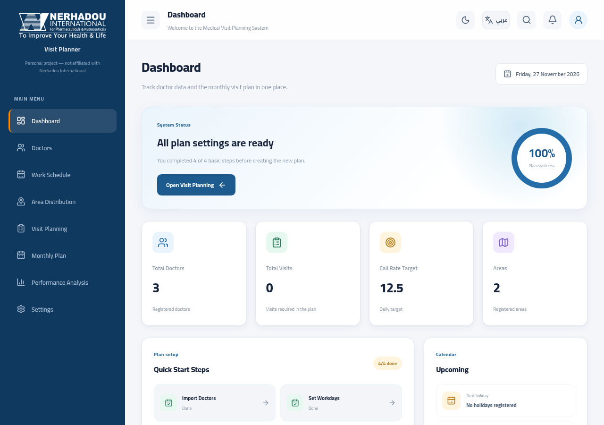
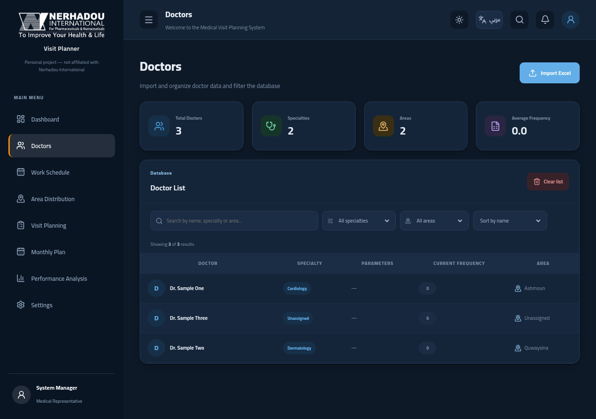
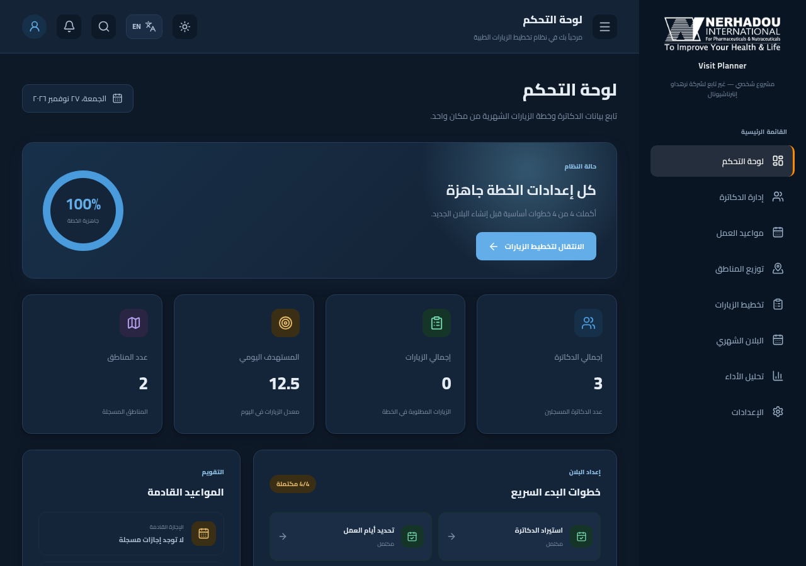
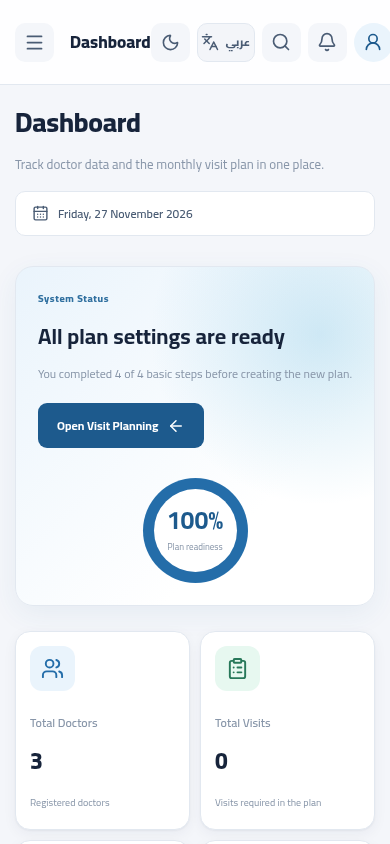

# Medical Visit Planner

> **Personal project — not affiliated with Nerhadou International.**
> All demo data and screenshots use synthetic sample data only.

A React web app that plans a medical representative's monthly doctor visits: import a doctor list from Excel, set workdays and area groups, and generate a balanced visit plan that respects visit frequencies, area grouping, and a daily call-rate target.

**Live demo:** https://mostafa-98.github.io/Nerhadou-planner/

## Features

- **Excel import** — tolerant importer that accepts Arabic or English headers (many spellings), needs only name, area and frequency; skips total rows, parses Arabic-Indic digits, and names missing columns in its error messages.
- **Visit plan generation** — a planning engine (runs in a Web Worker) distributes visits across the plan period respecting each doctor's requested frequency, area groups (only compatible areas share a day), one area group per day, holidays and meetings, and a daily call-rate target. Reports honestly when constraints make the target unreachable.
- **Monthly plan & performance** — calendar view of the generated plan and per-doctor performance analysis.
- **Bilingual UI** — full Arabic/English interface with RTL/LTR switching, including engine messages and importer errors.
- **Light & dark themes**, responsive down to phone screens.
- **Private by design** — all data stays in the browser (localStorage); nothing is sent to a server.

## Tech

React + Vite, Web Workers for plan generation, SheetJS (xlsx) for Excel parsing, CSS custom properties for theming.

## Screenshots

| | |
| --- | --- |
|  |  |
|  |  |

## Run locally

```bash
npm install
npm run dev
```

Build for production:

```bash
npm run build
```
